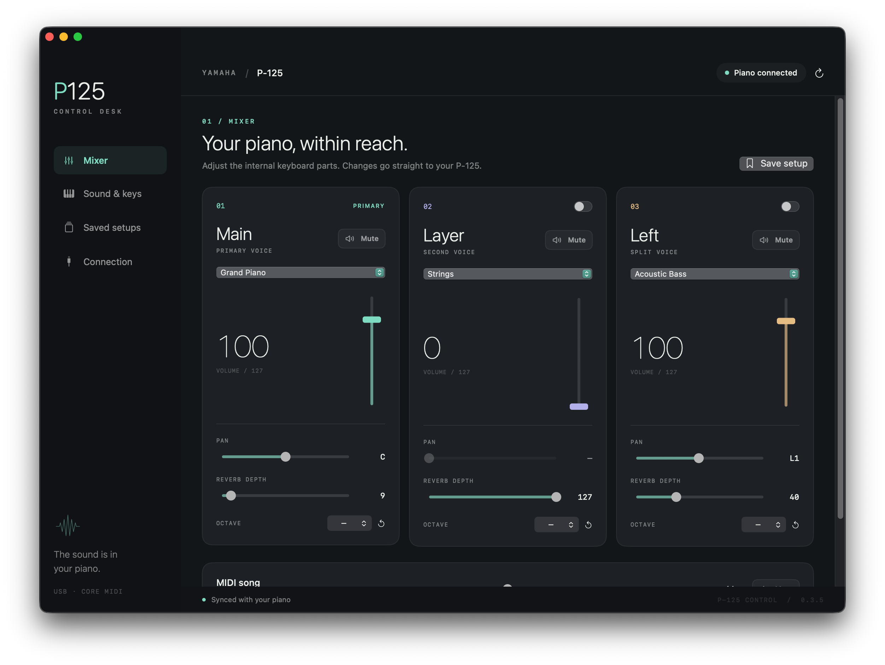
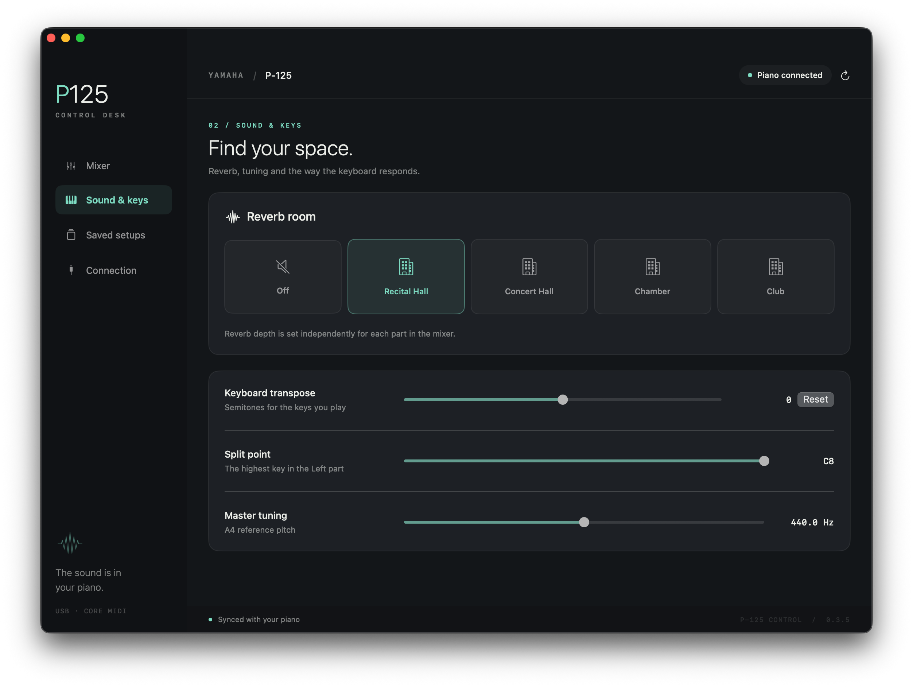
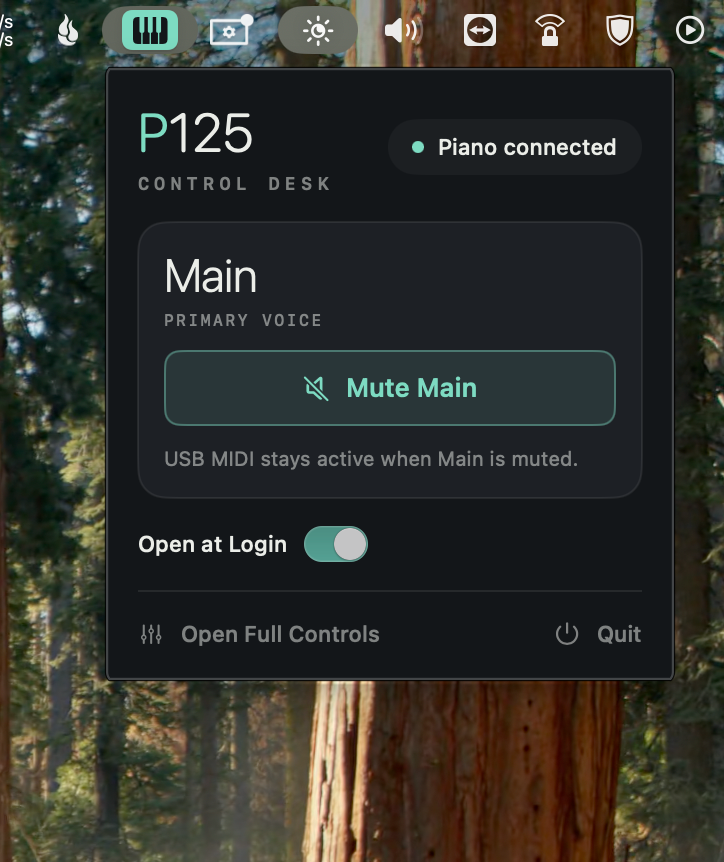
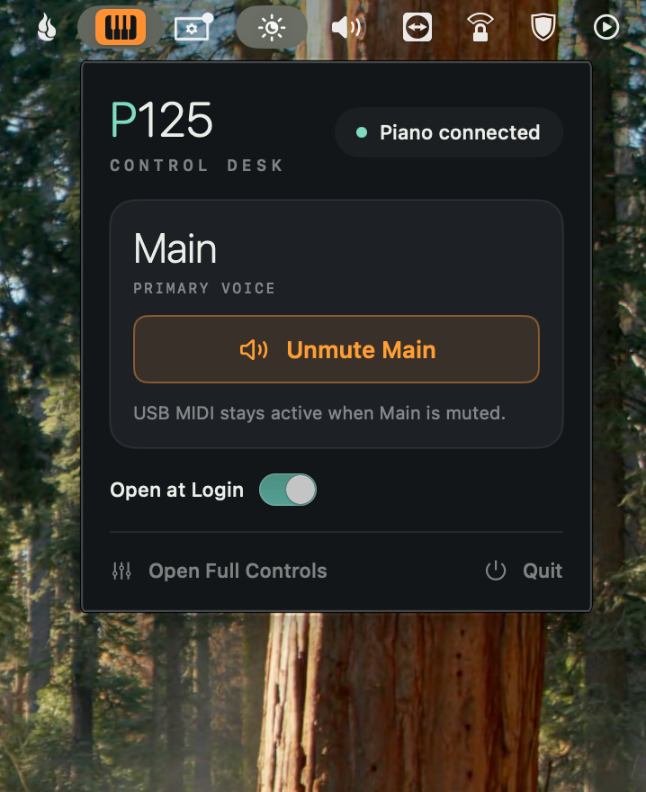
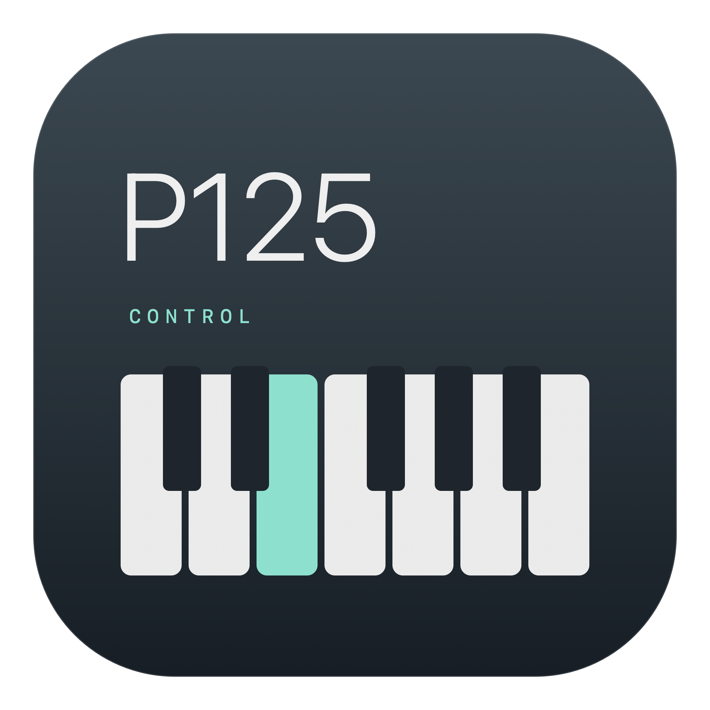

# Yamaha P-125 Control Utility

An independent macOS alternative to Yamaha Smart Pianist for controlling selected P-125 settings over USB, with quick access to Main mute directly from the menu bar. Built natively for macOS with Swift, SwiftUI, AppKit and CoreMIDI.

## Why I Built This

This project started as a personal solution to a specific problem I encountered with my Yamaha P-125.

I wanted to play software instruments on my Mac using the P-125 as a MIDI controller, while hearing the computer's audio through the piano's built-in speakers.

The challenge was muting the piano's internal sound without disabling its keyboard, MIDI functionality, or speakers.

I originally built this utility for my own use. I'm sharing it publicly in case it is useful to someone else.

The utility controls the piano's settings. Your music software and macOS audio settings handle computer audio routing and sound generation. Select the piano as your software instrument's audio output if you want to hear it through the piano's speakers.

## Development and Testing

I developed Yamaha P-125 Control Utility using OpenAI Codex and manually tested it on my Mac mini M4 Pro.

I created it primarily for personal use to solve a specific MIDI and audio workflow problem.

This is an unofficial independent project and is not affiliated with, sponsored by, or endorsed by Yamaha, Apple, or OpenAI.

Codex generated the implementation under my direction. Automated tests check protocol parsing, message framing and known device replies. My manual testing covers my own P-125 and workflow. This testing does not establish exhaustive coverage of every setting, firmware version or hardware configuration.

## Screenshots

### Mixer



### Sound & keys



### Menu bar controls

| Main unmuted | Main muted |
| --- | --- |
|  |  |

### Application icon



## Requirements and Download

- Apple Silicon Mac running macOS 14 or later.
- Yamaha P-125 and a USB cable connected to its USB TO HOST port.
- Compatibility is verified only with the P-125. Other Yamaha models are outside the tested scope.
- The installed app uses system frameworks and requires no development tools.

Download the DMG and optional SHA-256 checksum from [GitHub Releases](https://github.com/gilshirwi/Yamaha-P125-Control-Utility/releases).

## Install

1. Open the DMG and drag **P-125 Control.app** onto the **Applications** shortcut.
2. Eject the disk image and open **P-125 Control** from Applications.
3. If macOS blocks the first launch, open **System Settings → Privacy & Security**, select **Open Anyway**, and follow the confirmation prompt.

The application and its bundled login helper are ad-hoc signed. Ad-hoc signing is not Apple notarization. The app has no Developer ID signature. Approve a download only when you trust its source. [Apple's first-launch instructions](https://support.apple.com/en-us/102445)

To verify the DMG, download its checksum file into the same folder and run:

```sh
shasum -a 256 -c P-125-Control-0.3.5-arm64.dmg.sha256
```

## Connect and Read Settings

Turn on the piano, connect USB TO HOST to your Mac, and open the utility. It identifies the P-125, reads its current settings, and displays **Piano connected**. Opening or reconnecting reads the instrument's settings without applying defaults or a saved setup.

The app reads keyboard transpose first and enables controls as values arrive. It refreshes settings while connected. Press **⌘R** to request a fresh read.

## Menu Bar Controls

Click the piano icon in the menu bar to open the compact controls. **Mute Main** sets the piano's internal Main part volume to zero while keyboard MIDI transmission remains active. **Unmute Main** restores the remembered volume. Layer and Left have separate mute controls in the full mixer.

The piano icon has a mint background when connected with Main unmuted, an orange background when connected with Main muted, and no colored background while disconnected.

Closing the main window removes the Dock icon and keeps the utility running in the menu bar. Select **Open Full Controls** to reopen the window and return the Dock icon. Select **Quit** in the compact controls to exit, or right-click the Dock icon while the main window is open and select **Quit**.

Enable **Open at Login** in the compact controls to start in the menu bar when you sign in. Disable it using the same control or **Login Items** in System Settings. The app includes its login helper.

## Main Window

| View | Controls |
| --- | --- |
| **Mixer** | Main, Layer and Left volumes and mute, Layer and Split activation, voice selection, reverb depth, octave, pan where supported, and MIDI song playback balance and mute. |
| **Sound & keys** | Four reverb room presets and Off, keyboard transpose, split point, and A4 reference tuning. |
| **Saved setups** | Save settings locally, recall a setup, or restore the settings read at the start of the connection. |
| **Connection** | Reconnect, view firmware, and inspect the instrument response log. |

Voice pickers offer all 24 built-in sounds, grouped by type. Drag a slider or scroll over it to adjust its value. Double-click a slider, its value, or an octave selector to reset the parameter.

Settings and saved setups stay on this Mac. The application runs locally and has no server or third-party package dependencies.

## Behavior and Limitations

- **Main mute scope.** Main mute silences the primary internal voice. If Layer or Left is active, mute those parts separately when you want to silence them too.
- **Keyboard transpose.** Keyboard and MIDI song transpose use separate targets. The utility controls keyboard transpose. **Reset** returns it to zero. Older saved setups containing song transpose retain that field separately.
- **Mute recovery.** Muting remembers each part's volume and leaves its fader at that level. Moving a muted fader changes the volume that will be restored. Recovery values persist across reconnections and in saved setups. A nonzero hardware volume update clears stale mute state.
- **Octave readback.** Tested P-125 firmware 1.03 reports zero even after accepting an octave change. The utility displays **—** until an octave is selected in the current connection, then retains the last confirmed selection. The reset button always sends zero. Saved setups omit unknown octave settings.
- **Layer pan.** Unavailable on the tested P-125 with firmware 1.03.
- **Audio and MIDI.** The utility adjusts the internal sound engine. MIDI note routing, Local Control and computer audio routing remain under the instrument, macOS and music software's control.
- **Persistence.** Settings retained by the piano after the app closes or the instrument powers off depend on its firmware.
- **Auto Power Off.** The utility currently has no control for this setting.

## Build

Building requires an Apple Silicon Mac with macOS 14 or later and Xcode development tools with Swift 5.9 or later.

```sh
zsh tools/build.sh
version=$(plutil -extract CFBundleShortVersionString raw tools/Info.plist)
open "dist/$version/P-125 Control.app"
```

The build script creates an arm64 release, preserves the generated application icon, bundles the login helper and signs both bundles locally. It remaps compiler paths and strips shipped executables. A rebuild preserves an app bundle used by an already running instance. You can also open `Package.swift` in Xcode.

## Package a DMG

```sh
zsh tools/package-dmg.sh
```

The script verifies the application's architecture, deployment target, runtime dependencies and signature. It creates the DMG and a matching checksum beside the app and diagnostic executable in `dist/<version>/`. The DMG contains the app and an Applications shortcut. Generated files remain outside Git.

## Automated Tests and Diagnostics

Run the automated tests without a piano:

```sh
swift test
```

The read-only diagnostic requires a connected P-125:

```sh
swift run p125
```

After building, these commands perform additional checks on the connected instrument:

```sh
version=$(plutil -extract CFBundleShortVersionString raw tools/Info.plist)
"dist/$version/p125" --roundtrip
"dist/$version/p125" --verify-controls
"dist/$version/p125" --transpose-state
"dist/$version/p125" --verify-keyboard-transpose
```

`--transpose-state` only reads settings. The other checks temporarily change settings and attempt to restore their previous values. The read-only diagnostic can save a JSON snapshot with `--snapshot /path/to/file.json` and raw replies with `--log /path/to/file.log`. Keep private diagnostics out of public commits.

## Source Layout

- `Sources/P125Core` contains CoreMIDI communication, message encoding, parsing and SysEx assembly.
- `Sources/P125Control` contains the UI, state synchronization and saved setups.
- `Sources/P125CLI` contains the macOS hardware diagnostic.
- `Sources/P125LoginLauncher` contains the bundled login helper.
- `Tests/P125CoreTests` contains automated protocol tests.
- [Protocol notes](docs/PROTOCOL.md) describe the instrument's observed behavior.
- [Third-party resources](docs/THIRD_PARTY.md) describe system resources and protocol research.

## License

The project's original source code is released under [The Unlicense](LICENSE), permitting use, modification and redistribution, including commercial use, without an attribution requirement. Third-party names, system resources and external documentation remain subject to their respective terms.
